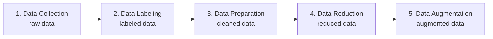

# WK2 · AI 系统基础 Fundamentals of Building AI Systems

> 对应课件：`MIS3011_26WK2_Fundamentals of Build AI Systems.pdf`（56 页）
> 关键词：AI system vs AI model、development lifecycle、scoping、AI-ready data、feature engineering

## 1. AI Model vs. AI System（必考概念区分）

- **AI Model**：a learned component that turns inputs into predictions, generations, and decisions/actions（把输入变成预测/生成/决策的学习组件）。它只是 AI 系统的一个组成部分。
- **AI System**：AI-powered software or computer systems——strategically designing and deploying a software that integrates AI models to solve a specific user or business problem and deliver **measurable values**（解决特定问题并交付可衡量的价值）。

<b>An AI model is only one component of an AI system.</b> 考试看到 "AI system = AI model" 这类等式，一律判错。

AI 系统的关键组件（按课件）：AI model、data、interface、tools、evaluation、monitoring、users。还有四大维度理解 AI 模型：

| Dimension | 内容 |
|---|---|
| Capability / Output | predictive, generative, decision/action |
| Modality | text, vision, audio, multimodal |
| Learning Method | supervised, unsupervised, self-supervised, reinforcement |
| Model Type | task-specific models vs. foundation models |

Key components of AI systems 的四个视角：**Purpose and stakeholders**（为什么存在、谁用）、**Data and infrastructure**（数据管道与算力）、**Model output and action**（预测/生成进入产品或人的工作流）、**Operation and feedback**（部署、监控、业务分析让系统持续运转）。

## 2. AI System Development Lifecycle（6 阶段迭代流程）

课件用 "Should this ad be shown?" 的真实案例说明：每个阶段发现问题都会把你**送回前面的阶段**，开发是迭代（iterative）而非线性的。

| 阶段 | 做什么 | 案例中的教训 |
|---|---|---|
| 1. Project Scoping | 定目标、利益相关者、资源 | 上线后没人点广告 → 指标选错，回到 scoping 把 metric 从 impressions 改成 click-through rate |
| 2. Data Engineering | 收集高质量、相关的数据 | 标签 99.99% 是 negative → 模型只会说"不显示" → 回 data 收集更多正样本 |
| 3. AI Model Development | 训练或选型 | 用两个月前的测试集表现好、昨天的数据表现差 → 回 data 更新数据 |
| 4. Deployment | 接入现有系统/人的工作流 | 明确在哪运行、多快、不确定时怎么办（低置信度请求进人工队列） |
| 5. Monitoring & Continual Learning | 上线后持续观察 | 五个监控维度见下 |
| 6. Business Analysis | 业务是否真的变好 | 模型报告 routing accuracy 98%，但业务问的是"客户更快拿到答复了吗、成本降了吗、满意度升了吗" |

**Monitoring 的五个维度**（选择题高频）：
1. **Task quality**——请求是否被分错部门、草稿被 agent 重写了多少
2. **Latency**——从新请求到正确队列 / 出草稿的耗时
3. **Cost**——每个 routed request / 每个 draft 的成本
4. **Reliability**——新型请求出现时工作流是否还 work
5. **Risk**——草稿承诺退款或泄露隐私数据

模型指标好 ≠ 业务结果好。Business analysis 问的是业务问题（客户更快拿到答复了吗？），不是模型指标（accuracy 98%）。判断题把两者划等号即错。

### 2.1 Scoping：什么时候该用 AI/ML

AI is **not a magic tool that can solve all problems**。AI 解决方案一般做的事：*learn complex patterns from existing data, and uses those patterns to make predictions on unseen data or produce new content*。

课件列出 9 个适合用 AI 的信号（理解即可，选择题能认出来）：

1. The system has the capacity to learn
2. There are patterns to learn, and they are **complex**
3. Data is available, or it's possible to collect data
4. Predict unseen data which **shares patterns with the training data**
5. Generate new content (text, code, images, audios…)
6. It's **repetitive**
7. The cost of wrong predictions is **cheap**
8. It's **at scale**
9. The patterns are **constantly changing**

<b>案例判断练习</b>（课件 P15，考试可能换个案例重考）：

<ul>
<li>预测公平骰子的下一次结果 → 不该用 AI（<b>没有可学习的复杂模式</b>，纯随机）</li>
<li>按 Elon Musk 推文预测币价 → 不该用（模式不存在/信噪比太低）</li>
<li>把 Airbnb 房源按所在州分类 → 不该用（规则确定，写规则就行，不用学）</li>
<li>把上百万封邮件分 Trash 与否 → 该用（重复、大规模、复杂模式、错误成本低）</li>
<li>用 2008 年的数据预测 2026 年 app 下载 → 不该用（<b>unseen data 不 shares patterns with training data</b>，模式已漂移）</li>
</ul>

### 2.2 Framing AI Problems（三要素框架）

把商业问题翻译成 AI 问题，由三样东西定义：

- **Input**（输入是什么）
- **Output**（输出是什么）
- **Learning objective**（学习目标是什么）

案例：银行客服提速 → 瓶颈是把请求分到四个部门之一 →
Input: the customer request；Output: one of four departments；Objective: as few misrouted requests as possible。

三要素口诀：<b>进什么、出什么、优化什么</b>（input / output / objective）。解释题问"如何把商业问题转成 AI 问题"，就答这三要素。

### 2.3 AI Task Types（三大任务类型）

| 类型 | 输出 | 例子 |
|---|---|---|
| **Classification** | a category or set of labels（类别/标签） | Spam 识别、情感分析 |
| **Regression** | a numerical estimate（数值估计） | 房价预测 |
| **Generation** | content, such as text or an image（内容生成） | 邮件回复 |

案例中的第二个 AI 问题（Route 之后还有 Draft）：Input = the customer request + relevant policy + available order facts；Output = a draft reply of up to 200 words with a clear next step；Objective = clear, appropriate, free of sensitive disclosures; address request with useful next step; respect format constraints。

### 2.4 一个 AI 系统 = 确定性软件 + 多个 AI 模型 + 人工判断

银行客服系统五步：**Route**（模型1·classification）→ **Retrieve**（查政策和订单事实）→ **Draft**（模型2·generation）→ **Review**（support agent 检查）→ **Reply**（发给客户）。

> The best solution may combine **deterministic software, multiple AI models, and human judgment**.

### 2.5 Model Development：两条路线

| | Custom AI development | Cloud-based AI（pre-built models） |
|---|---|---|
| 做法 | 从头用自己的数据训练（CNNs、RNNs、Transformers…） | 用预训练模型 + fine-tune 定制 |
| 适合 | 需要特定模型、要求深度控制 | 快速集成、常见场景 |
| 要求 | 深入技术知识：选框架（TensorFlow/PyTorch/Keras）、定义 layers/activation/output layers、定义 hyperparameters（batch size, epochs, learning rate）、用 metrics（accuracy, F1 score）评估 | 基础 AI 与 web 编程知识：prepare data → select pre-trained model → modify architectures → update parameters → evaluate |

模型去哪找：**Major Cloud Providers**（AWS、GCP、Azure，提供 close-sourced 模型 API）vs **Model Hubs**（Hugging Face、ModelScope，托管 open-sourced 模型）。

Hugging Face / ModelScope 上的是 <b>open-sourced</b> 模型；云厂商 API 多为 <b>close-sourced</b> 模型。把两者张冠李戴是经典陷阱。

## 3. Prepare AI-Ready Data（数据五步流水线）

**AI-ready data**：Data that has been prepared and processed for AI model training。Raw → AI-ready 的五步（理解顺序与每步产出物）：

五步法对应产物：raw → labeled → cleaned → reduced → augmented。<b>顺序题/配对题高频</b>。注意 reduction 在 augmentation 之前。

### Step 1 · Data Collection

数据来源：**public datasets**（公开共享）、**internal data**（组织自身运营产生）、**web scraping**（自动抓取网页）、**APIs and online services**（Twitter API、Bloomberg API）、**IoT devices and sensors**、**crowdsourcing**（Amazon Mechanical Turk）、**synthetic data**（模拟/生成模型人工造数）、**transactional data**（交易记录）。

知名公开数据集（记住名字和用途配对）：

| 数据集 | 内容 |
|---|---|
| **ImageNet** | 1400 万+ 标注图像，CV 模型训练标配 |
| **Common Crawl** | petabytes 级网页数据仓库， powering many LLMs |
| **Wikipedia** | 各领域文本数据 |
| **YouTube-8M** | 800 万标注视频，视频理解 |
| **Awesome Public Datasets** | 高质量公开数据源清单 |

### Step 2 · Data Labeling

Data labeling = *the process of identifying the outputs that you want machines to learn or predict*。来源：crowdsourcing、external sources、labeling function（程序化标注）、expert annotation。

**Manual labeling workflow** 四步：1) Decide what to be labeled → 2) Design the labeling interface → 3) Set clear labeling instructions → 4) **Quality assurance (QA)**

**Human annotation 的四大缺点**：1) Time-consuming 2) Expensive 3) **High annotator disagreement** 4) Non-private

What to Label 的核心思路：<b>先想 AI 问题是什么，再决定标什么</b>。

例：情感分析 → 标 review 文本 + Positive/Negative/Neutral；图片质检 → 标 [Rejected/Approved] + 原因标签（如 Impure Background、Bad Lighting、Not Centered），一个样本可带<b>多个标签</b>。

### Step 3 · Data Preparation（清洗 + 特征提取 + 特征变换）

**Data Cleaning**——给数据加约束让模型更容易学：
- **Missing data**：Deletion（删缺失过多的行列）或 **Imputation**（用 0、空串、mean/median/mode 等统计量填充）
- **Outlier removing**：outlier = an observation which deviates so much from the other observations。危害：让算法不正常工作、引入噪声、样本代表性下降

**Feature Extraction** 两条路线（重要对比）：
- **Feature engineering（manual）**：人工从现有特征造新特征；对非结构化数据用 NLP/CV 技术提特征
- **Representation learning（automated）**：深度学习模型**自动**学习预测所需的特征（如 CNN 自动学习图像特征的 spatial hierarchies）

CV 特征提取例子：Edge Detection、Corner Detection、Color Histograms 是人工特征；**CNNs 是 representation learning**。

**Feature Transformation**：
| 方法 | 作用 |
|---|---|
| **Binning** | 连续特征离散化（如收入分低/中/高三档） |
| **One-hot encoding** | 类别变量 → 二进制变量。**注意 dummy variable trap：Team_A/B/C 三个不能全要，留 n-1 个**（否则完全共线） |
| **Log scaling** | 处理 skewed data（偏态数据） |
| **Min-max scaling（normalization）** | 缩放到 [0,1] |
| **Z-score scaling（standardization）** | 变成"距均值几个标准差" |

normalization 与 standardization 别混：min-max 缩到 [0,1] 固定区间；z-score 以均值和标准差为中心，<b>没有固定上下界</b>。选择题常给场景让你选方法。

### Step 4 · Data Reduction（先减再加）

- **Feature Reduction**：drop highly correlated columns（去掉高度相关列）、remove low-variance features、用统计检验选 top-K（**F-test**：数值特征与 Y 的关系强弱；**Chi-squared**：类别特征与 Y 的依赖性）
- **Sample Reduction**：在保持 representativeness 和 class distribution 的前提下缩小数据集：
  - **Random sampling**（随机抽样）
  - **Stratified sampling**（分层抽样——**事先知道分组**，保持各组比例）
  - **Clustering-based sampling**（分组靠数据模式**自动发现**）

Stratified vs Clustering sampling：stratified <b>know the groups beforehand</b>；clustering 的 groups 是 <b>discovered through data patterns</b>。这是选择题的经典区分点。

### Step 5 · Data Augmentation

定义：*artificially create new data from existing data*，扩大训练数据量。图像增强手段：**Crop / Rotate / Flip**（基础变换）；**Filters（blur, sharpen）、Color（brightness, contrast, saturation）、Noise**（增强）。实施策略：单用或组合、随机化变换顺序、变化参数强度。

## 4. Takeaway：开始训练前问 5 个问题

Assess AI-ready data before you start training：

1. **Can you get it?**——谁拥有数据，会不会合法给你？
2. **Is the output recorded in there?**——你想预测的东西必须在数据里（或能被造出来）某处存在
3. **Is it new enough?**——数据多旧会让答案变错？
4. **Does it cover who you serve?**——从某一群体采的数据只能服务那个群体
5. **Is there enough of it for the AI problem you chose?**——不是"数据量大不大"，是"够不够解决你选的问题"

<b>WK2 Lab 关联</b>：lab 用 Airbnb 数据（AB_NYC_2019.csv）走了一遍 data collection → cleaning（缺失值处理、outlier 处理）→ transformation 的流程，并用 coding agent 生成提交报告。核心概念与本讲一一对应：你在 lab 里做的 dropna/填充、去极端价格、日期特征构造，都是 Data Preparation 的落地。

---

## 📝 本讲自测

1. 【判断】AI system 就是以 AI model 为核心的软件，模型是系统中最重要的部分。（答案：错。model is only one component；系统还包括 data、interface、evaluation、monitoring、users 等。）
2. 【选择】下列哪一项不是 monitoring 的维度？A) Task quality B) Latency C) 模型参数量 D) Risk（答案：C）
3. 【判断】用 2008 年数据训练预测 2026 年 app 下载量是一个合适的 AI 应用。（答案：错。unseen data 不再与训练数据共享模式。）
4. 【选择】把类别变量 Team_A/Team_B/Team_C 做 one-hot encoding 时，应该保留几个二进制变量？A) 3 个 B) 2 个 C) 1 个 D) 看情况（答案：B。避免完全共线。）
5. 【判断】Stratified sampling 与 clustering-based sampling 的区别在于分组是事先已知还是由数据模式发现。（答案：对。）
6. 【解释】用 input / output / objective 三要素描述"自动审核商品图片是否合格"的 AI 问题。（参考：Input: 新上传的商品图片；Output: Approved/Rejected + 原因标签；Objective: 尽可能少误判，并解释拒绝原因。）
7. 【判断】Feature engineering 是自动化过程，representation learning 是人工过程。（答案：错。说反了。）
8. 【选择】数据偏态（skewed）严重时应优先考虑：A) Min-max scaling B) Log scaling C) One-hot encoding D) Z-score（答案：B。log scaling 专门处理 skewed data。）
