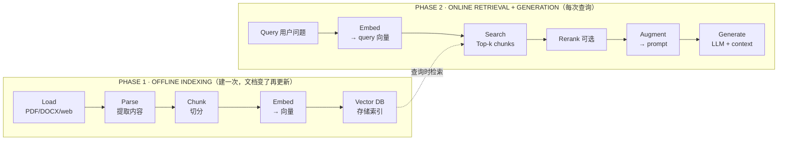

# WK9 · Grounding LLMs：给模型喂上实时、私有、个人的数据

> 对应课件：`MIS3011_26WK9_Grounding LLMs.pdf`（71 页）
> 关键词：grounding、prompt stuffing、tool calling、web search workflow、RAG（indexing/retrieval/chunking/hybrid search/rerank）、database、failure modes、RAG eval metrics

## 1. 为什么需要 Grounding

**LLM 的知识三局限**：LLM ≈ "zip file of the internet"，参数里存的知识**过期几个月**；没有外部工具时，模型只知道训练数据里有的东西。

| 局限 | 例子 |
|---|---|
| **Real-time** | 今日股价、新闻、订单 |
| **Private** | 公司政策、产品手册、员工手册 |
| **Personal** | 我的课表、日程、deadline |

**Grounding 的定义**（Microsoft FastTrack 引用）：the process of using LLMs with information that is **use-case specific, relevant, and not available as part of the LLM's trained knowledge**。**How**：在模型回答时供给信息——in the prompt、through tools、or through retrieval (RAG)。

### 六个实测案例的教训（考试可能换成别的场景）

课件用"凌晨 1 点校园里还有便利店开着吗"问了 6 个系统，失败的五大模式：

| What went wrong | 表现 |
|---|---|
| **Internal memory** | 不搜索时凭记忆回答，听着合理但是编的（hallucination） |
| **Outdated** | 搜到旧页面；新事实还没上网 |
| **Unstable** | 不同问法、不同运行、不同模型答案不同 |
| **Hidden** | ChatGPT 过滤了过时来源，但你看不到也控制不了那一步 |
| **Misrouted** | 问题被发到了错误的知识库（HR assistant） |

**对症方案**——Supply right data to LLMs：

- 少量事实 → 放进 prompt
- 实时公开信息 → web search
- 私有信息 → knowledge base（RAG）
- 结构化记录 → database

## 2. Workflow 1 · Prompt Stuffing（把所有资料塞进 prompt）

- WK7 的 chatbot 就是这么做的：约 11,000 字符的店铺事实放在 system prompt 里，**每个问题都带着全部事实**。
- Context window 从 4K tokens（GPT-3.5）涨到 1M+（Gemini 2.5）——long context 让这条路在大规模下成为可能。

**Works when（适用条件）**：事实稳定且放进窗口后还有富余；模型需要**跨全部事实推理**；简单性重于成本（如模型选型、快速 demo）。

**Limitations（局限，判断题素材）**：
- 每个问题都携带整个 prompt → **成本更高、回答更慢、事实会丢失**
- 企业事实太多且**不断变化**
- **No source**：答案出自哪条事实无法追溯

## 3. Technique 1 · Tool Calling（工具调用）

**核心机制**：The model does not run any tools. **It decides which tool to call and with what arguments; your application runs the tool and hands the result back to the model.**（模型只决定调哪个工具、传什么参数；真正执行的是你的应用。）

三个术语配对：Tools（给模型的功能）/ Tool calls（模型请求使用工具）/ Tool call outputs（工具产出喂回模型）。三个名字：Function calling（OpenAI 2023 年原始名）= Tool calling（现通用名）= Tool use（Anthropic 名）。

**调用流程五步**：① 带 tool definitions 请求模型 → ② 收到 tool call → ③ 应用侧执行代码 → ④ 把 tool output 放进第二次请求 → ⑤ 收到最终回答。

**三种工具**（分类题必考）：

| 类别 | 目的 | 例子 |
|---|---|---|
| **Knowledge augmentation** | 给模型它没有的信息 | web search、text retriever (RAG)、SQL executor、inventory API、email reader |
| **Capability extension** | 补上模型不擅长的 | calculator、code interpreter、image generation、OCR、speech-to-text |
| **Write actions** | 改变现实世界 | send an email、place an order、book a room、make a bank transfer |

① 模型自己执行工具吗？<b>不执行</b>——应用侧执行。② calculator 属于哪类？capability extension（不是 knowledge augmentation）——模型不会算，用计算器补能力。③ 搜索类工具属于 knowledge augmentation。

## 4. Workflow 2 · Web Search

搜索 workflow：Start (query) → Tavily Search → LLM → End (answer)。初始设置：Search Depth = Basic、Max Results = 3。

**让搜索回答更好的四类改进**（P38 表格，考试绝佳素材）：

| 改进位置 | 改什么 | 例子 |
|---|---|---|
| 1. Search settings | Search Depth 更深 | Basic → Advanced |
| ↑ | Max Results 更多 | 3 → 5 |
| ↑ | Include Domains 可信站点 | cuhk.edu.cn |
| ↑ | Time Range 近期页面 | Day / Week / Month / Year |
| 2. Search input | LLM 改写搜索词 | "CUHK-Shenzhen, 港中深, convenience store, supermarket, 24 hours opening hours" |
| 3. Search output | LLM system prompt 规定怎么用结果 | "If not sure or see contradictory info, say so. Prefer the official university page or newer sources." |

要点：第一次测试可能搜到 OSU（俄亥俄州立）的结果——**搜索词要消歧、加限定词**。

## 5. Technique 2 · RAG（Retrieval Augmented Generation）

**为什么不是 web search 就够**（Why RAG）：公共网上**新旧页面并存、没有日期**，搜索按 relevance 而非 date 排名；私有数据（公司政策、产品手册、客户记录）**根本不在网上**。Keep your own knowledge base: **you choose what goes in, keep it current, and know where each answer came from.**

**RAG 是什么**：给 LLM 相关文档，让它**基于文档回答**。LLM-only 是 memorizer（凭记忆答）；LLM with RAG 是 **reader**（读文档答）。

> Retrieval helps only if it retrieves the right things.

### 5.1 两阶段总览（必背流程图）

一个 chunk → 一个向量；query 和 chunk 用**同一个 embedding model**。

### 5.2 Phase 1 的细节考点

**Parse**：表格要解析成 **Markdown** 保住结构（纯文本解析会把表格摊平、数字错位）；复杂内容（表格、图片、视频嵌入文本中）需要增强 parser 处理 multimodal content。

**Chunk（四种切分策略，对比必考）**：

| 策略 | 做法 | 优缺点 |
|---|---|---|
| **Fixed-size** | 定长（如 100 字符）硬切 | 简单，但会把词和句子切成两半（"Ho"+"urs"） |
| **Sentence-level** | 按句子边界（delimiter 如句号） | 完整但大小不一、有的过小 |
| **Chunk overlap** | 每个 chunk 开头回退一点，边界文本出现在两个 chunk 里 | 典型 overlap = chunk 大小的 **10–20%**；索引成本略增 |
| **Parent-child** | 小 chunk（如 200 tokens）做 **embed & search**，命中后返回**大 parent chunk**（如 2000 tokens）给 LLM | 小 chunk 找得准 + parent 提供完整上下文 |

切太大太小的教训（P48）：chunk 太小——"Opening Hours: Mon-Sun: 24h" 单独成块，回答"which store?"时名字在别的 chunk；chunk 太大——三个便利店挤一块，匹配被稀释、造成混淆。

**Embed & Index**：把文本变成 **dense vectors**，语义相近的文本在向量空间里距离近（similar meaning → small angle；different topic → large angle）。存入 **vector database**。

### 5.3 Phase 2 的细节考点

**Vector Search**：按相似度分数找语义最接近的内容。两个控制参数：
- **Top K**：返回的 chunk 数量上限（例 Top K=3）
- **Score threshold**：丢掉低于阈值的弱匹配（例 0.60 → Uchiyama Shoten 0.63 过线、Starbucks 0.55 被丢）

**Hybrid Search（混合搜索）**：vector search 可能漏掉**精确关键词匹配**，而课程代码、订单号、ID 这类 exact strings 恰恰靠关键词。Hybrid = 向量搜索 + 传统关键词搜索：

> score_hybrid = α · score_vector + (1 − α) · score_keyword

**Rerank（两阶段检索）**：vector search 分别 embed 问题和 chunk，粗；**reranker 把问题和 chunk 放在一起读**，更精确但太慢不能对每对都跑。流程：Search (hybrid) 取 many candidates → Rerank model 挑出 best few → LLM。例：问"晚上 9:30 哪里能理发"，vector search 排第一的是 21:10 关门的 Three Chairs，rerank 后 22:00 关门的 QC House 升第一。

**Query Transformation**：用户查询往往太模糊不适于检索，先转换：
- **Query rewriting**：用 LLM 改写成更好的检索词（"Is anything open late?" → "CUHK-Shenzhen campus stores open after midnight, 24 hours"）
- **Multi-query**：生成 3–5 个查询变体分别检索再合并结果（"剪个头" → 剪头发/理发/洗剪吹）

**Augment & Generate（grounded answers）**：system prompt 范式——"Answer using ONLY the context below. Cite the chunk you used. If the answer is not in the context, say 'I don't know.'" → 答案带引用 [chunk_18]，context 没有的就老实说不知道。

### 5.4 When to Use RAG（条件清单）

The knowledge…：changes often（营业时间、政策）· is not in the model（内部文档）· must be cited（答案要经得起核查）· must stay private；
AND your constraints…：documents are too many for one prompt · a short delay is acceptable。

## 6. RAG 的能力边界与评估

### 6.1 Does well vs Struggles（实测）

- **Does well**：单点事实（在哪、几点、菜单）；换种说法也能匹配（"My glasses are loose"）；KB 里已有的新信息（Qingshui Dukou）
- **Struggles**：**Lists and counts**——检索不保证返回所有匹配记录（Q5：Top K=3 只召回 6 个中的 2 个；Top K=10 召回 5 个）；**缺失信息被读成 "Yes"**（Q6：没写寒假营业时间 → 模型答"Yes 24 小时"）

### 6.2 Two Failure Modes（先定位再修！）

- **Retrieval failure**：对的文档/chunk 没被找到（Q5：FamilyMart 的 chunk 不在检索出的 10 个里）→ 修检索侧（调 Top K、chunking、hybrid search）
- **Generation failure**：对的文档找到了但答案错了（Q6：FamilyMart 检索到了，但"no holiday hours"被说成 "Yes"）→ 修生成侧（system prompt）

> **Find out which stage failed (retrieval or generation) before you fix anything.**

### 6.3 四个评估指标（配对必考）

| Stage | Metric | 测什么 |
|---|---|---|
| Retrieval | **Context Recall** | 需要的文档里实际抓到了几成 |
| Retrieval | **Context Precision** | 抓回来的里面有多少真的有用 |
| Generation | **Faithfulness** | 答案是否被 context 支持（无幻觉） |
| Generation | **Answer Relevancy** | 答案是否真的回答了问题 |

（ragas、deepeval 等框架用 LLM-as-a-judge 自动跑这些指标。）

## 7. Workflow 4 · Database（列表、计数、筛选）

**为什么需要数据库**：
- RAG 返回语义上最相似的 chunks，**不保证完整性**；database query 返回**所有满足条件的行**
- 大量业务数据本来就在表里（订单、库存、客户记录、学生记录）
- 需要 counting、filtering、sorting（最早开的、总共几个、按价格排序）

自然语言（给人读的一段话）vs 结构化数据（给程序查询的字段值表）。Database workflow：User Input (question + CSV) → **LLM 1 生成 SQL**（写 tool call 的参数）→ **CSV SQL Query 工具执行** → **LLM 2 基于返回的行作答**。注意："If the model writes the wrong SQL, the answer will also be problematic."

## 8. 四种 Grounding 方式对比（总结表，压轴必背）

| | Prompt | Web search | RAG | Database |
|---|---|---|---|---|
| **事实住在哪** | 你的 prompt 里 | 公共互联网 | 你的文档里 | 你的表格里 |
| **适合** | 少量稳定事实 | 实时公开信息 | 私有文档、多种问法 | 列表、计数、筛选 |
| **小心** | 太长、无出处 | 旧页面、过滤过程不可控 | 漏 chunk、计数错 | 模型写错 SQL |

> Real systems combine them; **picked by the question.**

**Takeaways**：① Grounding = 给模型它没有的事实；② Tool calling = 模型说调什么、应用执行并回传；③ RAG 一步一步建、一步一步评估（Parse · chunk · embed · retrieve · augment；retrieval vs. generation）；④ 按问题选信息源。

<b>WK9 Lab 关联</b>：lab 要求导入 Search Workflow、用 Tavily key + OpenRouter 上的 z-ai/glm-5.3-flash 跑"凌晨 1 点便利店"问题，截 Before 图，再从搜索设置 / 搜索词改写 / system prompt 三处改进，截 After 图，最后 Publish as Tool（命名 Campus_Life_Search）——这个流程本身就是"评估→定位失败→改进→再评估"的闭环，是 AS2 的基础。

---

## 📝 本讲自测

1. 【判断】Tool calling 中，模型自己负责执行工具代码。（答案：错。模型只决定调哪个工具、传什么参数；应用在应用侧执行。）
2. 【选择】calculator 属于哪类工具？A) Knowledge augmentation B) Capability extension C) Write action D) 都不是（答案：B）
3. 【排序】RAG 离线索引五步：① Embed ② Vector DB ③ Load ④ Chunk ⑤ Parse。（答案：③⑤④①②）
4. 【判断】Fixed-size chunking 的优点是永远不切断句子和词。（答案：错。它会把词和句子切成两半；不断句是 sentence-level 的优点。）
5. 【选择】Parent-child chunking 的思想是：A) 大 chunk 检索、小 chunk 生成 B) 小 chunk 检索、命中返回大 chunk C) 随机切块 D) 不分块（答案：B）
6. 【判断】Hybrid search 是为了同时覆盖语义相似匹配和精确关键词匹配。（答案：对。）
7. 【选择】Rerank 放在检索的哪个阶段？A) 粗检索前 B) 粗检索后、生成前 C) 生成后 D) 随时（答案：B。两阶段：先取 many candidates，再 rank 出 best few。）
8. 【情景】RAG 系统被问"寒假 FamilyMart 还开吗"，检索到了正确 chunk（里面没写寒假营业时间），但回答"是的 24 小时开"。这是：A) Retrieval failure B) Generation failure C) 都不是 D) 两者（答案：B。对的文档找到了但答案错 → 修 system prompt。）
9. 【配对】Context Precision 测：抓回来的内容里有多少有用；Faithfulness 测：答案是否被 context 支持。（判断：对）
10. 【选择】"校园里晚上 10:30 还有哪些地方能买吃的、一共几家？"这类问题最适合：A) Prompt stuffing B) Web search C) RAG D) Database（答案：D。列表 + 计数 + 筛选是数据库的活，RAG 不保证召回全部。）
11. 【判断】四种 grounding 方式互斥，一个系统只能选一种。（答案：错。Real systems combine them; picked by the question.）
